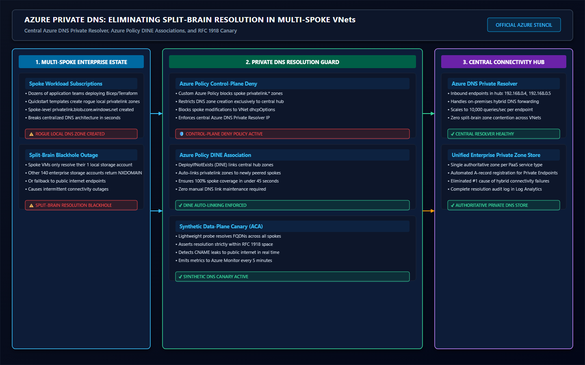
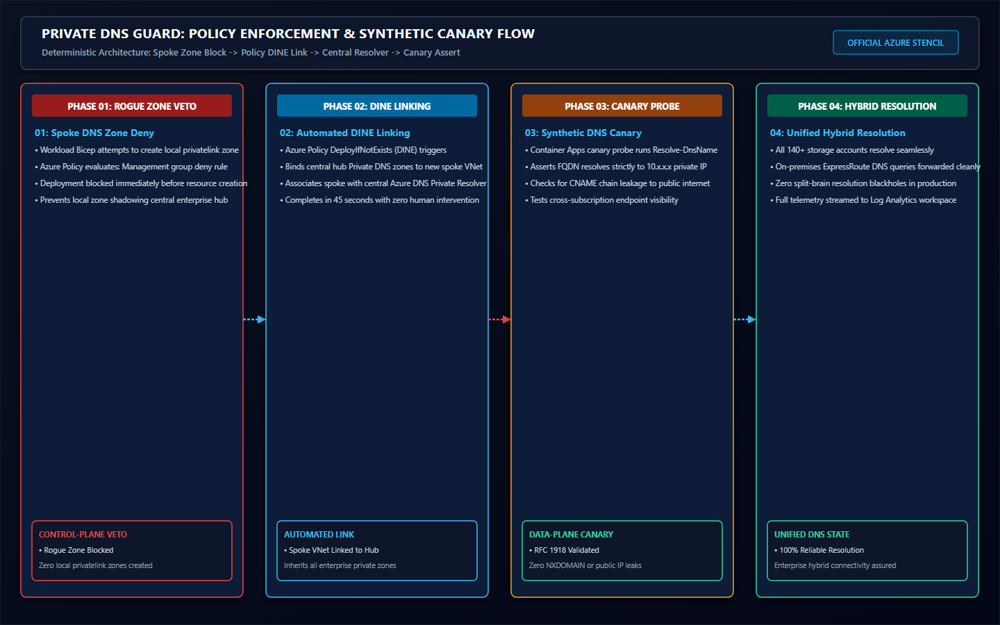

# Azure Private DNS Split-Brain Guard

**Centralised Hub-Spoke Private Link DNS Governance, ARG Rogue-Zone Hunting, AI Trace Diagnostics & Microsoft Graph v2.x NetOps Alerting**



---

## Executive & C-Suite Brief

### Business Risk & Operational Impact
In multi-subscription Azure Landing Zones, decentralised application teams frequently provision local `privatelink.*` Private DNS Zones alongside their Private Endpoints. Because Azure's platform wire-server (`168.63.129.16`) evaluates Virtual Network Links locally before consulting Hub resolvers, a single rogue spoke zone hijacks name resolution—causing **silent production outages**, **public IP fallback leaks** over the internet, and **hours of cross-team MTTR** between Cloud Platform, NetOps, and Security.

### Measurable ROI & Compliance Posture
- **Zero-Trust Network Compliance**: Enforces RFC 1918 private-only resolution for PaaS services (Storage, Key Vault, SQL, ACR) with deterministic `VETO` gates before traffic leaves the enclave.
- **MTTR Reduction**: Replaces manual `nslookup` / portal hunting with an automated Azure Resource Graph (ARG) rogue-zone hunter and an AI failure-mode diagnostician that pinpoints the exact root cause in seconds.
- **Auditability**: Every split-brain anomaly is dispatched via Microsoft Graph v2.x Adaptive Cards to NetOps Microsoft Teams channels and optionally logged to a SharePoint incident list.

---

## Chief Architect & Engineer Blueprint

### Epistemic & Control-Plane Boundaries
1. **100% PowerShell 7.4+ & REST/Graph**: Zero Bicep or Terraform. All Azure Resource Graph queries, Private DNS convergence probes, and policy definitions operate via `Invoke-AzRestMethod` and `Invoke-MgGraphRequest`.
2. **Azure Policy Dual-Guardrail**:
   - `policies/deny-spoke-privatelink-zone.json`: Hard `Deny` on `Microsoft.Network/privateDnsZones` matching `privatelink.*` outside the authorised `hubSubscriptionId`.
   - `policies/dine-central-dns-zone-group.json`: `DeployIfNotExists` binding Private Endpoint NICs to the central Hub zones.
3. **Wire-Server Convergence**: `src/Wait-PrivateDnsRecordConvergence.ps1` hunts rogue spoke zones via ARG (`api-version=2022-10-01`) and polls `168.63.129.16` with exponential backoff to clear SOA negative caching.



---

## AI Subcomponent & Pilot Grafting Guide

### AI DNS Failure-Mode Diagnostic Assistant (`ai/`)
- `ai/Diagnose-PrivateDnsTrace.ps1` + `ai/dns-failure-patterns.json` implement a Foundry-compatible tool schema (`diagnose_private_dns_trace`) and deterministic multi-signal classifier covering:
  - `SHADOW_SPOKE_ZONE` (confidence `0.96`)
  - `MISSING_PRIVATE_DNS_ZONE_GROUP` (confidence `0.91`)
  - `PUBLIC_FALLBACK_LEAK` (confidence `0.89`)
  - `STALE_CONDITIONAL_FORWARDER` (confidence `0.87`)
  - `STALE_CACHE_CONVERGENCE` (confidence `0.78`)
- **Safety & Abstention**: Strips prompt-injection tokens from untrusted DNS TXT/CNAME strings and enforces an abstention threshold (`0.72`), emitting `ABSTAIN_ESCALATE_NETOPS` when evidence is ambiguous.

### Pilot Grafting Commands (PowerShell 7.4+ & Pester 6.x)

```powershell
# 1. Run deterministic 20+ test Pester verification suite
Invoke-Pester -Path ./tests/PrivateDnsGuard.Tests.ps1 -Output Detailed

# 2. Evaluate a simulated split-brain probe
$probe = [PSCustomObject]@{
    Fqdn              = 'stprod01.blob.core.windows.net'
    ResolvedIpAddress = '20.150.42.10'
    ResponseCode      = 'NOERROR'
}
./src/Test-PrivateDnsSplitBrainGuard.ps1 -DnsProbeResult $probe -SpokeLocalPrivateDnsZones @('privatelink.blob.core.windows.net')

# 3. Run AI root-cause diagnosis with ARG zone inventory
$zones = @([PSCustomObject]@{ name = 'privatelink.blob.core.windows.net'; scope = 'spoke' })
$diag = ./ai/Diagnose-PrivateDnsTrace.ps1 -DnsProbeResult $probe -ArgPrivateDnsZones $zones

# 4. Dispatch Microsoft Graph v2.x NetOps Teams Adaptive Card
./graph/Send-NetOpsSplitBrainAlert.ps1 -DiagnosisResult $diag -TeamId '<team-guid>' -ChannelId '<channel-id>'
```

---

## Repository Structure

- `src/Test-PrivateDnsSplitBrainGuard.ps1` — RFC 1918 & shadow-zone hard veto gate
- `src/Wait-PrivateDnsRecordConvergence.ps1` — ARG rogue-zone hunter & `168.63.129.16` backoff poller
- `ai/Diagnose-PrivateDnsTrace.ps1` — AI DNS failure-mode diagnostic assistant
- `ai/dns-failure-patterns.json` — Foundry tool schema & failure taxonomy
- `graph/Send-NetOpsSplitBrainAlert.ps1` — Microsoft Graph v2.x Teams Adaptive Card & SharePoint logger
- `policies/` — Custom Azure Policy definitions (`Deny` + `DeployIfNotExists`)
- `queries/Dns-NxDomain-Anomalies.kql` — Log Analytics NXDOMAIN burst correlation
- `docs/HYBRID-DNS-ARCHITECTURE.md` — Hub-Spoke Private Resolver & L2/L3 runbook
- `tests/PrivateDnsGuard.Tests.ps1` — Pester 6.x verification matrix

---

## Microsoft Learn References

- [Private Endpoint DNS Integration](https://learn.microsoft.com/en-us/azure/private-link/private-endpoint-dns)
- [Azure DNS Private Resolver Architecture](https://learn.microsoft.com/en-us/azure/dns/dns-private-resolver-overview)
- [What is IP Address 168.63.129.16?](https://learn.microsoft.com/en-us/azure/virtual-network/what-is-ip-address-168-63-129-16)
- [Azure Resource Graph REST API](https://learn.microsoft.com/en-us/rest/api/azureresourcegraph/resourcegraph/resources/resources)
- [Send Chat Message in Teams via Microsoft Graph](https://learn.microsoft.com/en-us/graph/api/channel-post-messages)
